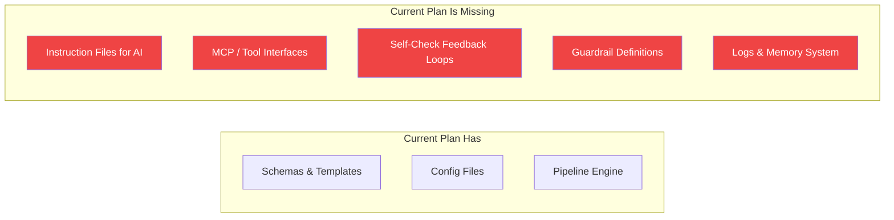
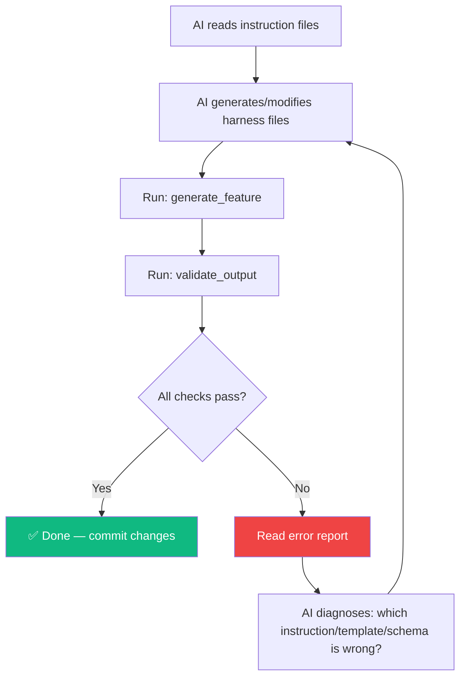
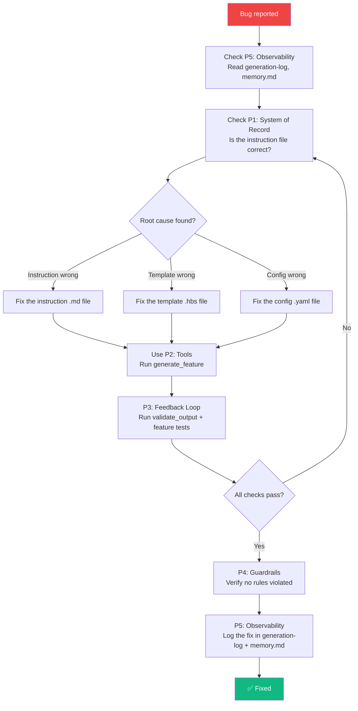

# 🔍 Gap Analysis & Revised Plan — AI Harness 5 Pillars × 5 Layers

## The Correct 5 Pillars of AI Harness Engineering

| # | Pillar | What It Means | Current Plan Coverage |
|---|--------|---------------|----------------------|
| **P1** | **System of Record (Instruction Files)** | The single source of truth that tells the AI agent *what* to build — markdown specs, schema definitions, design docs | 🟡 Partial — schemas/configs exist but no instruction files for the AI |
| **P2** | **Tools (MCP, Scripts, etc.)** | The capabilities the AI agent can invoke — MCP servers, CLI scripts, code generators, template processors | 🟡 Partial — engine exists but not exposed as AI-callable tools |
| **P3** | **Feedback Loop (Self-Checks)** | Mechanisms for the AI to verify its own output — build checks, test runs, visual diffs, linting | 🔴 Missing — validators exist but no self-check loop for AI |
| **P4** | **Guardrails (What It Can't Do)** | Boundaries and constraints — protected files, forbidden patterns, scope limits, safety rules | 🔴 Missing entirely |
| **P5** | **Observability (Logs & Memory)** | How the AI tracks what it did, what worked, what failed — generation logs, decision history, memory files | 🔴 Missing entirely |

---

## What the Current Plan Gets Wrong

> [!WARNING]
> The current plan treats the harness as a **traditional code-generation engine** — a pipeline that a human runs manually. But an AI Harness is designed to be **driven by an AI agent**. The 5 pillars are about structuring the AI agent's working environment, not just a build pipeline.

### Critical Gaps



**Gap 1 — System of Record**: The plan defines schemas and templates but has no **instruction files** — structured markdown documents that tell the AI agent "here is what the Tasks feature should do, here are the acceptance criteria, here are the constraints." Without this, the AI has no source of truth to reason from.

**Gap 2 — Tools**: The engine components (`template-processor.js`, `schema-parser.js`) exist but aren't exposed as **tools the AI can call**. There's no MCP server, no tool definitions. The AI can't invoke `generate_feature`, `validate_output`, or `run_migration` as discrete operations.

**Gap 3 — Feedback Loop**: Validators exist but there's no **closed loop** where the AI generates code → checks the result → fixes issues → re-checks. No build verification, no test runner, no visual screenshot comparison.

**Gap 4 — Guardrails**: Nothing prevents the AI from editing `output/` directly, generating unsafe code, exceeding scope, or breaking other features. No rules file, no protected paths, no constraint definitions.

**Gap 5 — Observability**: No logs of what was generated, no memory of past generation runs, no decision audit trail. The AI can't answer "what did I change last time and did it work?"

---

## Revised Architecture: 5 Pillars × 5 Layers

### How the Pillars Map to Layers

The key insight: **each pillar must exist at every layer**. An instruction file exists at the base level (Layer 1) and at the feature level (Layer 2). Tools exist at the engine level (Layer 0) and as feature-specific scripts (Layer 2). And so on.

```
                   P1: System    P2: Tools    P3: Feedback   P4: Guardrails  P5: Observability
                   of Record                  Loop
┌────────────────┬─────────────┬────────────┬──────────────┬───────────────┬─────────────────┐
│ L4: Compose    │ app-spec.md │ assemble   │ e2e smoke    │ feature-scope │ generation      │
│                │ page specs  │ tool       │ test         │ limits        │ manifest log    │
├────────────────┼─────────────┼────────────┼──────────────┼───────────────┼─────────────────┤
│ L3: Customize  │ override    │ theme      │ override     │ override      │ override        │
│                │ instructions│ tools      │ validators   │ constraints   │ changelog       │
├────────────────┼─────────────┼────────────┼──────────────┼───────────────┼─────────────────┤
│ L2: Features   │ feature     │ feature    │ feature      │ feature       │ feature         │
│                │ specs (.md) │ generators │ tests        │ boundaries    │ generation logs │
├────────────────┼─────────────┼────────────┼──────────────┼───────────────┼─────────────────┤
│ L1: Base       │ base specs  │ CRUD tools │ schema       │ base rules    │ base            │
│                │ & schemas   │ & scripts  │ validators   │ & constraints │ audit trail     │
├────────────────┼─────────────┼────────────┼──────────────┼───────────────┼─────────────────┤
│ L0: Engine     │ master      │ MCP server │ self-check   │ guardrail     │ logging         │
│                │ instruction │ tool defs  │ engine       │ engine        │ engine          │
└────────────────┴─────────────┴────────────┴──────────────┴───────────────┴─────────────────┘
```

---

## Pillar Deep-Dives (Across All Layers)

### P1: System of Record — Instruction Files

> The single source of truth. Every piece of the generated application traces back to an instruction file.

| Layer | File(s) | Purpose |
|-------|---------|---------|
| **L0** | `instructions/MASTER.md` | Master instruction: project vision, tech stack, conventions, coding standards |
| **L1** | `instructions/base/entity-spec.md` | How base entities work, common field rules, naming conventions |
| **L1** | `layer1/schemas/*.yaml` | Data model definitions (unchanged from original plan) |
| **L2** | `instructions/features/tasks.md` | Full specification: "Task has title, description, assignee, status…" with acceptance criteria |
| **L2** | `instructions/features/boards.md` | "Board has columns, each column has tasks, drag-drop reorders…" |
| **L2** | `instructions/features/auth.md` | "Users sign up with email, JWT auth, roles: admin, member, viewer…" |
| **L2** | `instructions/features/sprints.md` | Sprint planning spec with acceptance criteria |
| **L2** | `instructions/features/comments.md` | Comments spec |
| **L2** | `instructions/features/dashboard.md` | Dashboard spec |
| **L2** | `instructions/features/teams.md` | Teams spec |
| **L2** | `instructions/features/notifications.md` | Notifications spec |
| **L3** | `instructions/customization.md` | How overrides work, what can be customized |
| **L4** | `instructions/app-spec.md` | Full application spec: pages, navigation, user flows |

> [!IMPORTANT]
> These instruction files are **not just documentation**. They are the primary input the AI reads to understand what to generate. When a feature is wrong, you update the instruction file → the AI re-reads it → regenerates correctly.

### P2: Tools — MCP, Scripts, Generators

> The capabilities the AI agent can invoke to do work.

| Layer | Tool | What It Does |
|-------|------|-------------|
| **L0** | `tools/mcp-server.js` | MCP server exposing all harness tools to the AI agent |
| **L0** | `tools/generate.js` | Master generation command — reads instructions, applies templates, writes output |
| **L0** | `tools/validate.js` | Runs all validators and returns pass/fail report |
| **L0** | `tools/serve.js` | Starts the generated app locally for testing |
| **L1** | `tools/crud-generator.js` | Generates CRUD API + components for any entity schema |
| **L1** | `tools/migration-runner.js` | Creates and runs database migrations |
| **L2** | `tools/feature-scaffold.js` | Scaffolds a new feature module (schema + config + templates + tests) |
| **L2** | Each feature can register its own tools | e.g., `boards/tools/seed-columns.js` to populate default board columns |
| **L3** | `tools/apply-overrides.js` | Merges customization overrides into the generation context |
| **L4** | `tools/assemble-app.js` | Composes features into pages, generates routing and navigation |

**MCP Server Exposure** (example tool definitions):
```yaml
# tools/mcp-server.js exposes:
- name: generate_feature
  description: "Generate or regenerate a specific feature from its instruction file and schema"
  parameters:
    feature_name: string  # e.g., "tasks", "boards"

- name: validate_output
  description: "Run validation checks on the generated output"
  parameters:
    scope: string  # "all" | feature name

- name: run_app
  description: "Start the generated application locally"

- name: scaffold_feature
  description: "Create a new feature module with all required files"
  parameters:
    feature_name: string

- name: check_build
  description: "Build the generated app and report errors"
```

### P3: Feedback Loop — Self-Checks

> The AI generates → checks → fixes → re-checks. This loop ensures correctness without human intervention.

| Layer | Check | What It Verifies |
|-------|-------|-----------------|
| **L0** | `feedback/build-check.js` | Can the generated app build without errors? (`npm run build`) |
| **L0** | `feedback/lint-check.js` | Does the generated code pass linting? |
| **L0** | `feedback/self-check-runner.js` | Orchestrates all feedback checks and produces a report |
| **L1** | `feedback/schema-check.js` | Do all schemas conform to the base entity contract? |
| **L1** | `feedback/template-check.js` | Do templates produce valid syntax (JSX, SQL, etc.)? |
| **L2** | `feedback/feature-tests/tasks.test.js` | Does the generated Tasks API respond correctly? |
| **L2** | `feedback/feature-tests/boards.test.js` | Does the Board drag-drop work? |
| **L2** | `feedback/feature-tests/auth.test.js` | Does login/signup work? |
| **L3** | `feedback/override-check.js` | Do overrides apply without breaking the base? |
| **L4** | `feedback/e2e-smoke.js` | Can a user navigate through the entire app end-to-end? |

**The Self-Check Loop:**


### P4: Guardrails — What the AI Can't Do

> Hard boundaries that prevent the AI from going off-track, breaking things, or exceeding scope.

| Layer | Guardrail File | Rule |
|-------|---------------|------|
| **L0** | `guardrails/RULES.md` | Master guardrails document the AI must follow |
| **L0** | `guardrails/protected-paths.yaml` | Files/dirs the AI must NEVER edit directly |
| **L0** | `guardrails/engine-constraints.yaml` | Engine limits (max file size, max entities, etc.) |
| **L1** | `guardrails/schema-rules.yaml` | "Every entity MUST have id, createdAt, updatedAt" |
| **L1** | `guardrails/template-rules.yaml` | "Templates MUST NOT contain hardcoded credentials" |
| **L2** | `guardrails/feature-boundaries.yaml` | "A feature generator can ONLY write to its own output directory" |
| **L2** | `guardrails/forbidden-patterns.yaml` | "NEVER use eval(), NEVER inline SQL, NEVER store passwords in plaintext" |
| **L3** | `guardrails/override-limits.yaml` | "Overrides can change theme, add fields, but CANNOT delete base fields" |
| **L4** | `guardrails/scope-limits.yaml` | "The app is a local student PM tool — no payment processing, no cloud deploy" |

**Example `guardrails/RULES.md`:**
```markdown
# AI Harness Guardrails

## NEVER
- Edit any file inside `output/` directly
- Generate code that uses `eval()` or `Function()` constructor
- Store passwords or secrets in plaintext
- Remove fields from base-entity.yaml
- Add features not listed in the app-manifest.yaml
- Generate more than 50 files in a single run
- Modify the engine (Layer 0) to fix a feature bug

## ALWAYS
- Trace every change back to an instruction file
- Run validate_output after every generation
- Add a log entry for every generation run
- Follow the schema naming conventions in MASTER.md
- Generate tests alongside every feature
```

**Example `guardrails/protected-paths.yaml`:**
```yaml
protected:
  never_edit:
    - "output/**"           # Never directly edit generated output
    - "engine/**"           # Don't modify engine to fix feature bugs
    - ".git/**"             # Never touch git internals
    - "node_modules/**"
  
  edit_with_caution:
    - "layer1/schemas/base-entity.yaml"  # Changing this affects ALL features
    - "guardrails/**"                     # Meta-guardrail: don't weaken guardrails
```

### P5: Observability — Logs & Memory

> The AI needs to know what happened, what worked, what failed, and what decisions were made.

| Layer | File/System | Purpose |
|-------|------------|---------|
| **L0** | `observability/generation-log.jsonl` | Append-only log of every generation run (timestamp, features, result) |
| **L0** | `observability/error-log.jsonl` | All errors encountered during generation |
| **L0** | `observability/logger.js` | Logging engine used by all tools |
| **L1** | `observability/schema-changelog.md` | History of schema changes and why they were made |
| **L2** | `observability/feature-status.yaml` | Status of each feature: `planned | in-progress | generated | validated` |
| **L2** | `observability/feature-logs/tasks.log` | Per-feature generation history |
| **L3** | `observability/override-history.jsonl` | What overrides were applied and when |
| **L4** | `observability/app-manifest-history.jsonl` | Changes to the app composition over time |
| **All** | `observability/memory.md` | **AI Memory File** — persistent notes the AI writes to itself about decisions, gotchas, patterns learned |

**Example `observability/memory.md`:**
```markdown
# AI Memory — Harness Decisions & Learnings

## 2024-01-15
- Decided to use `uuid` for entity IDs instead of auto-increment because 
  SQLite auto-increment has issues with concurrent inserts.
- The Handlebars `{{#each}}` helper doesn't support `break` — had to use 
  a `{{#if}}` guard inside the loop for conditional rendering.

## 2024-01-16
- Board columns are ordered by a `position` integer field, not by array index.
  This is because SQLite doesn't have native array support.
- Task status transitions are validated server-side. Added a `transitions` 
  map in the task schema to enforce valid moves (e.g., "todo" → "in_progress" ✓, 
  "done" → "todo" ✗).
```

**Example `observability/generation-log.jsonl`:**
```json
{"timestamp":"2024-01-15T10:30:00Z","action":"generate","feature":"tasks","result":"success","filesGenerated":12,"duration":"2.3s"}
{"timestamp":"2024-01-15T10:35:00Z","action":"validate","feature":"tasks","result":"fail","errors":["Missing assignee field in list component"]}
{"timestamp":"2024-01-15T10:36:00Z","action":"generate","feature":"tasks","result":"success","filesGenerated":12,"duration":"2.1s","note":"Fixed assignee field in template"}
{"timestamp":"2024-01-15T10:37:00Z","action":"validate","feature":"tasks","result":"pass","checks":8}
```

---

## Revised Directory Structure

```
hrns-demo1/
├── README.md
├── package.json
│
├── instructions/                        # P1: SYSTEM OF RECORD
│   ├── MASTER.md                        # Master spec: vision, stack, conventions
│   ├── base/
│   │   └── entity-spec.md               # Base entity rules
│   ├── features/
│   │   ├── tasks.md                     # Task feature spec + acceptance criteria
│   │   ├── boards.md                    # Board feature spec
│   │   ├── auth.md                      # Auth feature spec
│   │   ├── sprints.md
│   │   ├── comments.md
│   │   ├── dashboard.md
│   │   ├── teams.md
│   │   └── notifications.md
│   ├── customization.md                 # How overrides work
│   └── app-spec.md                      # Full app: pages, nav, user flows
│
├── engine/                              # L0: HARNESS ENGINE
│   ├── index.js
│   ├── template-processor.js
│   ├── schema-parser.js
│   ├── config-loader.js
│   ├── file-writer.js
│   ├── pipeline-runner.js
│   └── validator.js
│
├── tools/                               # P2: TOOLS
│   ├── mcp-server.js                    # MCP server exposing all tools
│   ├── generate.js                      # Master generation tool
│   ├── validate.js                      # Validation runner
│   ├── serve.js                         # Local dev server launcher
│   ├── crud-generator.js                # L1 CRUD generation tool
│   ├── migration-runner.js              # DB migration tool
│   ├── feature-scaffold.js              # New feature scaffolder
│   ├── apply-overrides.js               # Override merger
│   └── assemble-app.js                  # Full app assembler
│
├── feedback/                            # P3: FEEDBACK LOOP
│   ├── self-check-runner.js             # Orchestrates all checks
│   ├── build-check.js                   # Build verification
│   ├── lint-check.js                    # Lint verification
│   ├── schema-check.js                  # Schema conformance
│   ├── template-check.js               # Template syntax validation
│   ├── override-check.js               # Override compatibility
│   ├── e2e-smoke.js                     # End-to-end smoke test
│   └── feature-tests/                   # Per-feature test files
│       ├── tasks.test.js
│       ├── boards.test.js
│       ├── auth.test.js
│       └── ...
│
├── guardrails/                          # P4: GUARDRAILS
│   ├── RULES.md                         # Master guardrails document
│   ├── protected-paths.yaml             # Files AI must not edit
│   ├── schema-rules.yaml                # Data model constraints
│   ├── template-rules.yaml              # Template safety rules
│   ├── feature-boundaries.yaml          # Feature isolation rules
│   ├── forbidden-patterns.yaml          # Banned code patterns
│   ├── override-limits.yaml             # Override scope limits
│   └── scope-limits.yaml                # App scope boundaries
│
├── observability/                       # P5: OBSERVABILITY
│   ├── logger.js                        # Logging engine
│   ├── generation-log.jsonl             # Generation run history
│   ├── error-log.jsonl                  # Error history
│   ├── schema-changelog.md              # Schema change history
│   ├── feature-status.yaml              # Feature status tracker
│   ├── override-history.jsonl           # Override application history
│   ├── app-manifest-history.jsonl       # Composition change history
│   ├── memory.md                        # AI memory / decision notes
│   └── feature-logs/
│       ├── tasks.log
│       ├── boards.log
│       └── ...
│
├── layer1/                              # L1: BASE SCHEMAS & TEMPLATES
│   ├── schemas/
│   │   └── base-entity.yaml
│   └── templates/
│       ├── crud-api.hbs
│       ├── crud-component.hbs
│       ├── db-migration.hbs
│       └── ui-kit.hbs
│
├── layer2/                              # L2: FEATURE GENERATORS
│   └── features/
│       ├── auth/
│       │   ├── schema.yaml
│       │   ├── config.yaml
│       │   └── templates/
│       ├── boards/
│       ├── tasks/
│       ├── sprints/
│       ├── comments/
│       ├── notifications/
│       ├── dashboard/
│       └── teams/
│
├── layer3/                              # L3: CUSTOMIZATION & OVERRIDES
│   ├── overrides/
│   │   ├── theme.yaml
│   │   └── fields/
│   ├── hooks/
│   └── extensions/
│
├── layer4/                              # L4: COMPOSITION
│   ├── app-manifest.yaml
│   ├── pages/
│   ├── navigation.yaml
│   └── routing.yaml
│
└── output/                              # GENERATED APP (never edit directly)
    ├── frontend/
    └── backend/
```

---

## Revised 5 Pillars × 5 Layers Matrix

| | **L0 Engine** | **L1 Base** | **L2 Features** | **L3 Customize** | **L4 Compose** |
|---|---|---|---|---|---|
| **P1: System of Record** | `MASTER.md` | `entity-spec.md` + schemas | `features/tasks.md` etc. | `customization.md` | `app-spec.md` |
| **P2: Tools** | MCP server, `generate.js`, `validate.js` | `crud-generator.js`, `migration-runner.js` | `feature-scaffold.js`, feature-specific tools | `apply-overrides.js` | `assemble-app.js` |
| **P3: Feedback Loop** | `self-check-runner.js`, `build-check.js`, `lint-check.js` | `schema-check.js`, `template-check.js` | `feature-tests/*.test.js` | `override-check.js` | `e2e-smoke.js` |
| **P4: Guardrails** | `RULES.md`, `protected-paths.yaml` | `schema-rules.yaml`, `template-rules.yaml` | `feature-boundaries.yaml`, `forbidden-patterns.yaml` | `override-limits.yaml` | `scope-limits.yaml` |
| **P5: Observability** | `logger.js`, `generation-log.jsonl`, `error-log.jsonl` | `schema-changelog.md` | `feature-status.yaml`, `feature-logs/` | `override-history.jsonl` | `app-manifest-history.jsonl`, `memory.md` |

---

## Revised Implementation Phases

### Phase 1: Foundations — Engine + System of Record + Guardrails
> Build Layer 0 engine, write the master instruction files, and establish guardrails from day one.

- [ ] Harness engine core (template processor, schema parser, config loader, file writer)
- [ ] `instructions/MASTER.md` — project vision, tech stack, naming conventions
- [ ] `guardrails/RULES.md` + `protected-paths.yaml` — establish boundaries immediately
- [ ] `observability/logger.js` — logging from the very first generation

### Phase 2: Tools + Base Layer
> Expose engine as callable tools, build Layer 1 primitives.

- [ ] `tools/mcp-server.js` — MCP server with tool definitions
- [ ] `tools/generate.js`, `tools/validate.js`, `tools/serve.js`
- [ ] `layer1/` — base entity schema, CRUD templates, UI kit
- [ ] `instructions/base/entity-spec.md`

### Phase 3: Feedback Loop + Core Features (Wave 1)
> Build the self-check system alongside the first features so every feature is validated from birth.

- [ ] `feedback/self-check-runner.js`, `build-check.js`, `schema-check.js`
- [ ] Feature: **Auth** (instruction file + schema + templates + tests)
- [ ] Feature: **Tasks** (instruction file + schema + templates + tests)
- [ ] Feature: **Boards** (instruction file + schema + templates + tests)
- [ ] Feature: **Teams** (instruction file + schema + templates + tests)

### Phase 4: Extended Features (Wave 2)
> Add remaining features with full pillar coverage.

- [ ] Feature: **Sprints**, **Comments**, **Dashboard**, **Notifications**
- [ ] Each with: instruction file, schema, templates, tests, feature-specific guardrails

### Phase 5: Customization + Composition + Observability Polish
> Wire everything together, enable overrides, and ensure full observability.

- [ ] Layer 3: override system, theme tools, custom fields
- [ ] Layer 4: app manifest, page composition, routing generation
- [ ] Full observability: `memory.md`, feature status tracker, complete audit trail
- [ ] End-to-end smoke test (`feedback/e2e-smoke.js`)

---

## Key Change: How Bug Fixes Work (Revised)

The flow now explicitly involves the 5 pillars:



---

## Summary of Changes from Original Plan

| Aspect | Original Plan | Revised Plan |
|--------|--------------|-------------|
| **5 Pillars** | Schema, Template, Config, Pipeline, Validation (code-gen concepts) | System of Record, Tools, Feedback Loop, Guardrails, Observability (AI agent concepts) |
| **Instruction Files** | ❌ None | ✅ `instructions/` dir with master + feature specs |
| **MCP / Tools** | ❌ Engine only (not AI-callable) | ✅ `tools/` dir with MCP server + discrete tools |
| **Self-Check Loop** | ❌ One-shot validation | ✅ `feedback/` dir with closed-loop self-checks |
| **Guardrails** | ❌ None | ✅ `guardrails/` dir with rules, protected paths, boundaries |
| **Observability** | ❌ None | ✅ `observability/` dir with logs, memory, changelogs |
| **Bug fix flow** | Trace to schema/template → regenerate | Read logs → check instructions → fix source → regenerate → self-check → log |
