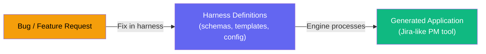
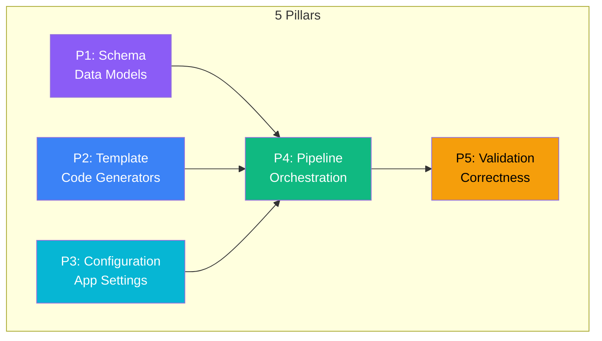
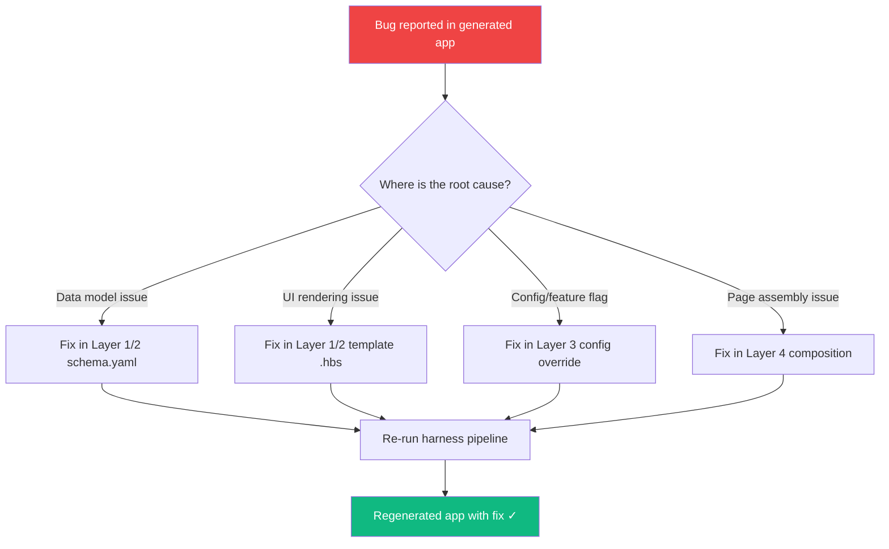

# 🏗️ Harness Architecture Plan — Student Project Management Platform

## The Core Philosophy

> **You never touch the generated application. You only touch the harness.**
> Every bug, feature, or design change in the generated Jira-like app is resolved by modifying the harness definitions — the harness then regenerates the corrected application.

---

## What Is a Harness?

A **harness** is a declarative code-generation framework. Instead of writing application code by hand, you define **schemas**, **templates**, **configurations**, and **rules**. The harness engine reads these definitions and **generates** the full working application. If the generated app has a bug, you fix the template or schema in the harness — never the generated output.



---

## The 5 Pillars of the Harness

Each pillar is a fundamental concern that the harness must address. Think of them as the **"what"** the harness manages:

| # | Pillar | Purpose | Example |
|---|--------|---------|---------|
| **P1** | **Schema** | Defines all data models, relationships, and constraints | `Task`, `Board`, `Sprint`, `User`, `Comment` entities |
| **P2** | **Template** | Code-generation templates that transform schemas into real code | EJS/Handlebars templates for React components, API routes, DB migrations |
| **P3** | **Configuration** | Declarative app-level settings (features, themes, auth, roles) | Feature flags, RBAC roles, UI theme tokens |
| **P4** | **Pipeline** | The build/generation orchestration that ties everything together | `generate → validate → build → serve` workflow |
| **P5** | **Validation** | Rules and tests that ensure generated code is correct | Schema validators, generated test suites, lint rules |



---

## The Layering Concept

The **layers** define **where** in the harness each concern lives. Each layer builds on top of the one below it, and higher layers can override lower ones. This creates a clean separation where foundational logic is never mixed with feature-specific customization.

```
┌─────────────────────────────────────────────────────┐
│  Layer 4: COMPOSITION & ORCHESTRATION               │  ← Ties features into pages/flows
│  (Page layouts, navigation, full-app assembly)      │
├─────────────────────────────────────────────────────┤
│  Layer 3: CUSTOMIZATION & OVERRIDES                 │  ← Student-specific tweaks
│  (Theme overrides, custom fields, hooks)            │
├─────────────────────────────────────────────────────┤
│  Layer 2: FEATURE GENERATORS                        │  ← Feature-specific templates
│  (Board generator, Sprint generator, Auth gen)      │
├─────────────────────────────────────────────────────┤
│  Layer 1: BASE SCHEMAS & TEMPLATES                  │  ← Shared primitives
│  (CRUD templates, base entity schema, UI kit)       │
├─────────────────────────────────────────────────────┤
│  Layer 0: HARNESS ENGINE                            │  ← Core framework
│  (Template processor, config reader, file writer)   │
└─────────────────────────────────────────────────────┘
```

### Layer Details

#### Layer 0 — Harness Engine (Core Framework)
The runtime that reads definitions and produces output files. This is the "brain" of the harness.

| Component | Responsibility |
|-----------|---------------|
| `engine/template-processor.js` | Reads `.hbs`/`.ejs` templates, merges with data, outputs files |
| `engine/schema-parser.js` | Parses YAML/JSON schema definitions into an in-memory model |
| `engine/config-loader.js` | Loads and merges layered configs (defaults → overrides) |
| `engine/file-writer.js` | Writes generated files to `output/` with conflict detection |
| `engine/pipeline-runner.js` | Orchestrates the generation phases in order |
| `engine/validator.js` | Runs validation rules against generated output |

#### Layer 1 — Base Schemas & Templates (Shared Primitives)
Reusable building blocks that are entity-agnostic. Any entity (Task, User, Sprint) uses these.

| Component | Responsibility |
|-----------|---------------|
| `layer1/schemas/base-entity.yaml` | Common fields: `id`, `createdAt`, `updatedAt`, `createdBy` |
| `layer1/templates/crud-api.hbs` | Generic REST CRUD route generator |
| `layer1/templates/crud-component.hbs` | Generic list/detail/form React component generator |
| `layer1/templates/db-migration.hbs` | Database table migration generator |
| `layer1/templates/ui-kit.hbs` | Base design system component stubs |

#### Layer 2 — Feature Generators (Domain-Specific)
Each "feature" of the Jira-like app is a self-contained generator module.

| Feature Module | What It Generates |
|----------------|-------------------|
| `layer2/features/auth/` | Login, signup, JWT middleware, RBAC guards |
| `layer2/features/boards/` | Kanban board components, drag-drop logic, board API |
| `layer2/features/tasks/` | Task CRUD, assignees, labels, priority, due dates |
| `layer2/features/sprints/` | Sprint planning, backlog management, velocity charts |
| `layer2/features/comments/` | Comment threads, mentions, activity feed |
| `layer2/features/notifications/` | In-app notifications, email triggers |
| `layer2/features/dashboard/` | Summary dashboard, charts, progress tracking |
| `layer2/features/teams/` | Team/group management for peer students |

Each feature folder contains:
```
layer2/features/tasks/
├── schema.yaml          # Task-specific data model (extends base-entity)
├── config.yaml          # Feature-specific settings (defaults)
├── templates/
│   ├── api-routes.hbs   # Task API routes
│   ├── components.hbs   # Task UI components
│   └── migration.hbs    # Task DB migration
└── validators/
    └── rules.yaml       # Task-specific validation rules
```

#### Layer 3 — Customization & Overrides
Where students customize the generated app without modifying lower layers.

| Component | Responsibility |
|-----------|---------------|
| `layer3/overrides/theme.yaml` | Color palette, typography, spacing overrides |
| `layer3/overrides/fields/` | Custom fields added to any entity |
| `layer3/hooks/` | Pre/post generation hooks (e.g., inject analytics) |
| `layer3/extensions/` | Custom templates that override Layer 1/2 templates |

#### Layer 4 — Composition & Orchestration
Defines how features are assembled into a complete application.

| Component | Responsibility |
|-----------|---------------|
| `layer4/app-manifest.yaml` | Master list of enabled features, their order, dependencies |
| `layer4/pages/` | Page-level composition (which features appear on which page) |
| `layer4/navigation.yaml` | Sidebar/navbar structure |
| `layer4/routing.yaml` | URL routing map |

---

## 5 Pillars × Layers Matrix

This matrix shows how each pillar manifests across the layers:

| | **Layer 0 (Engine)** | **Layer 1 (Base)** | **Layer 2 (Features)** | **Layer 3 (Customization)** | **Layer 4 (Composition)** |
|---|---|---|---|---|---|
| **P1: Schema** | Schema parser | `base-entity.yaml` | `tasks/schema.yaml`, `boards/schema.yaml` | Custom field overrides | Entity relationship map |
| **P2: Template** | Template processor (Handlebars) | `crud-api.hbs`, `crud-component.hbs` | `tasks/templates/`, `boards/templates/` | Override templates | Page layout templates |
| **P3: Config** | Config loader & merger | Default configs | Feature-specific configs | Theme/field overrides | `app-manifest.yaml` |
| **P4: Pipeline** | Pipeline runner | Base generation phases | Feature generation hooks | Pre/post hooks | Full app assembly order |
| **P5: Validation** | Validator engine | Base schema validators | Feature-specific rules | Override validators | Integration tests |

---

## Directory Structure

```
hrns-demo1/
├── README.md
├── package.json
│
├── engine/                          # Layer 0 — Harness Engine
│   ├── index.js                     # Main entry point
│   ├── template-processor.js        # Handlebars/EJS processor
│   ├── schema-parser.js             # YAML schema → in-memory model
│   ├── config-loader.js             # Layered config merger
│   ├── file-writer.js               # Output file writer
│   ├── pipeline-runner.js           # Orchestration pipeline
│   └── validator.js                 # Validation engine
│
├── layer1/                          # Layer 1 — Base Schemas & Templates
│   ├── schemas/
│   │   └── base-entity.yaml
│   └── templates/
│       ├── crud-api.hbs
│       ├── crud-component.hbs
│       ├── db-migration.hbs
│       └── ui-kit.hbs
│
├── layer2/                          # Layer 2 — Feature Generators
│   └── features/
│       ├── auth/
│       │   ├── schema.yaml
│       │   ├── config.yaml
│       │   ├── templates/
│       │   └── validators/
│       ├── boards/
│       │   ├── schema.yaml
│       │   ├── config.yaml
│       │   ├── templates/
│       │   └── validators/
│       ├── tasks/
│       │   ├── schema.yaml
│       │   ├── config.yaml
│       │   ├── templates/
│       │   └── validators/
│       ├── sprints/
│       ├── comments/
│       ├── notifications/
│       ├── dashboard/
│       └── teams/
│
├── layer3/                          # Layer 3 — Customization & Overrides
│   ├── overrides/
│   │   ├── theme.yaml
│   │   └── fields/
│   ├── hooks/
│   └── extensions/
│
├── layer4/                          # Layer 4 — Composition & Orchestration
│   ├── app-manifest.yaml
│   ├── pages/
│   ├── navigation.yaml
│   └── routing.yaml
│
└── output/                          # Generated Application (NEVER edit directly)
    ├── frontend/
    │   ├── src/
    │   │   ├── components/
    │   │   ├── pages/
    │   │   ├── styles/
    │   │   └── App.jsx
    │   ├── package.json
    │   └── index.html
    └── backend/
        ├── src/
        │   ├── routes/
        │   ├── models/
        │   ├── middleware/
        │   └── server.js
        ├── migrations/
        └── package.json
```

---

## Generated Application Features (What the Harness Produces)

The harness will generate a **Jira-like student project management app** with:

| Feature | Description |
|---------|-------------|
| **Kanban Boards** | Drag-and-drop task boards with customizable columns |
| **Task Management** | Create, assign, label, prioritize, set due dates |
| **Sprint Planning** | Time-boxed sprints with backlog grooming |
| **User Authentication** | Signup/login with JWT, peer student roles |
| **Team Management** | Create study groups, assign members |
| **Comments & Activity** | Threaded comments, @mentions, activity feed |
| **Dashboard** | Summary charts — burndown, velocity, task distribution |
| **Notifications** | In-app alerts for assignments, mentions, due dates |

---

## Tech Stack for Generated App

| Layer | Technology |
|-------|-----------|
| Frontend | React (via Vite) + Vanilla CSS |
| Backend | Node.js + Express |
| Database | SQLite (local-first, no server needed) |
| Auth | JWT tokens (local, peer-friendly) |
| State | React Context + useReducer |
| Build | Vite |

> [!NOTE]
> SQLite is chosen because this is a **local application** for peer students — no cloud database setup required.

---

## Implementation Phases

### Phase 1: Harness Engine (Layer 0)
Build the core engine that can read schemas, process templates, and generate files.

**Deliverables:**
- [ ] Template processor (Handlebars-based)
- [ ] YAML schema parser
- [ ] Config loader with layered merge
- [ ] File writer with output directory management
- [ ] Pipeline runner (sequential phase execution)
- [ ] CLI entry point (`node engine/index.js generate`)

### Phase 2: Base Primitives (Layer 1)
Create the reusable, entity-agnostic templates and schemas.

**Deliverables:**
- [ ] `base-entity.yaml` with common fields
- [ ] CRUD API route template
- [ ] CRUD React component template (list + detail + form)
- [ ] Database migration template
- [ ] Base UI kit template (buttons, inputs, cards, modals)

### Phase 3: Core Feature Generators (Layer 2 — Wave 1)
Build the first set of critical feature generators.

**Deliverables:**
- [ ] **Auth** feature (login, signup, JWT, roles)
- [ ] **Tasks** feature (full CRUD, assignees, labels, priority)
- [ ] **Boards** feature (Kanban columns, drag-drop)
- [ ] **Teams** feature (group management)

### Phase 4: Extended Feature Generators (Layer 2 — Wave 2)
Add remaining features.

**Deliverables:**
- [ ] **Sprints** feature (sprint planning, backlog)
- [ ] **Comments** feature (threaded comments, mentions)
- [ ] **Dashboard** feature (charts, progress)
- [ ] **Notifications** feature (in-app alerts)

### Phase 5: Customization Layer (Layer 3)
Enable overrides and extensions without touching lower layers.

**Deliverables:**
- [ ] Theme override system
- [ ] Custom field injection
- [ ] Pre/post generation hooks
- [ ] Template override mechanism

### Phase 6: Composition & Polish (Layer 4)
Wire everything into a complete, navigable application.

**Deliverables:**
- [ ] App manifest with feature toggles
- [ ] Page composition definitions
- [ ] Navigation and routing generation
- [ ] Full end-to-end generation test

---

## How Bug Fixes Work (Harness-First Principle)

> [!IMPORTANT]
> **Golden Rule**: Never edit files in `output/`. Always trace the bug to a harness definition.

**Example workflow:**

```
Problem: "Tasks page doesn't show the assignee field"

1. Check: layer2/features/tasks/schema.yaml
   → Is 'assignee' defined? If not, add it.

2. Check: layer2/features/tasks/templates/components.hbs
   → Does the list template render 'assignee'? If not, fix template.

3. Re-run: node engine/index.js generate
   → Harness regenerates output/ with the fix applied.

4. Verify: The tasks page now shows assignees ✓
```



---

## Key Design Decisions to Confirm

> [!WARNING]
> The following decisions will shape the entire harness. Please review before we proceed.

1. **Template Engine**: Handlebars (`.hbs`) — simple, logic-less, widely understood. Alternative: EJS (more flexible but messier). **Recommendation: Handlebars.**

2. **Schema Format**: YAML — human-readable, easy for students. Alternative: JSON Schema (more strict). **Recommendation: YAML.**

3. **Database**: SQLite — zero-config, local-first. Alternative: PostgreSQL (more powerful but needs setup). **Recommendation: SQLite.**

4. **Frontend Framework**: React via Vite — fast, modern, good DX. Alternative: Vanilla JS (simpler but more tedious). **Recommendation: React + Vite.**

5. **Generation Strategy**: Full regeneration (wipe `output/` and regenerate). Alternative: Incremental (only regenerate changed files). **Recommendation: Start with full regeneration, add incremental later.**

---

## Next Steps

Once this plan is approved, I will begin with **Phase 1** — building the harness engine (Layer 0). This is the foundation that everything else depends on.

**Estimated build order:**
1. Engine core → ~1 session
2. Base templates → ~1 session
3. Core features (auth, tasks, boards) → ~2 sessions
4. Extended features → ~2 sessions
5. Customization + composition → ~1 session
6. Polish + full integration → ~1 session
